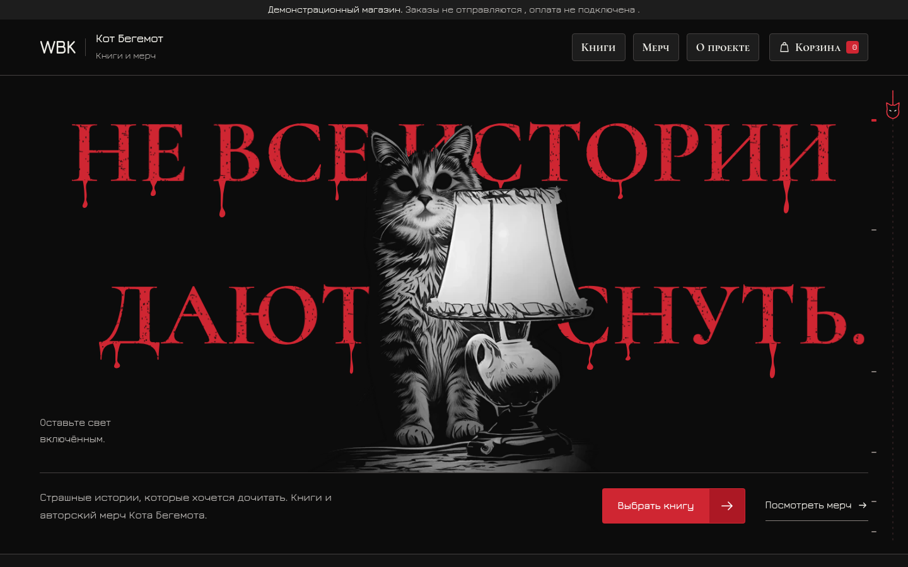
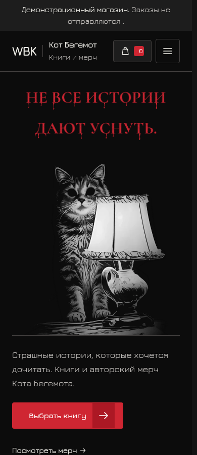

<div align="center">
​
# WBK Shop
​
**Книги, от которых не уснуть.**  
Демонстрационная витрина книжной лавки «Кот Бегемот»: хоррор, мерч и чёрно-алая эстетика.
​


​
[Возможности](#возможности) · [Запуск](#быстрый-запуск) · [Структура](#структура-проекта) · [Проверки](#проверки) · [Ограничения](#ограничения)
​
</div>
​
---
​
## Превью
​

​
<details>
<summary>Скриншоты из проекта: десктоп и мобильная версия</summary>
​
### Десктоп
​

​
### Мобильная версия
​

​
</details>
​
## О проекте
​
**WBK Shop** — статический фронтенд-прототип магазина книг и мерча. Визуальная основа — хоррор-постер: тёмный фон, фактурный алый заголовок, органичные потёки и кот в центре композиции.
​
Сайт написан на **HTML, CSS и чистом JavaScript**. Не требует npm, сборки или серверной части; изображения и шрифты поставляются локально.
​
> **Важно:** это демонстрационный магазин. Форма создаёт локальный черновик, а не оформляет заказ. Отправка заказов и оплата не подключены.
​
## Возможности
​
- **Каталог:** фильтрация по категориям, поиск, сортировка по цене и названию.
- **Корзина:** добавление товаров, изменение количества, удаление и расчёт суммы.
- **Мерч:** выбор размера футболки перед добавлением в корзину.
- **Сохранение корзины:** через `localStorage`, когда хранилище доступно в браузере.
- **Черновик заказа:** проверка полей формы и скачивание списка товаров в `.txt`.
- **Адаптивный интерфейс:** мобильное меню и оформление для разных размеров экрана.
- **Клавиатурная навигация:** управление диалогами, закрытие через `Escape` и возврат фокуса.
- **Визуальные эффекты:** нить прокрутки и поддержка настройки уменьшения движения (`prefers-reduced-motion`).
​
## Быстрый запуск
​
### Вариант 1 — открыть файл
​
1. Скачайте и распакуйте **весь архив** проекта.
2. Откройте `index.html` в браузере.
​
Сохраняйте структуру каталогов: `assets/`, CSS и JavaScript должны оставаться на своих местах.
​
### Вариант 2 — локальный HTTP-сервер
​
Если установлен Python 3, откройте терминал в папке с `index.html` и выполните:
​
```bash
python3 -m http.server 8765
```
​
Затем перейдите на **http://localhost:8765**. Для остановки сервера нажмите `Ctrl+C`.
​
> Самому сайту Python не нужен — он используется только для локального сервера.
​
## Структура проекта
​
```text
WBK-Shop-v3/
├── index.html          # Разметка и SVG-оформление главного заголовка
├── styles.css          # Основные стили и компоненты
├── refinements.css     # Уточнения постера, навигации и контактов
├── app.js              # Каталог, корзина и черновик заказа
├── effects.js          # Визуальные эффекты
├── assets/             # Иллюстрации, товары, локальные шрифты и иконки
├── previews/           # Скриншоты десктопной и мобильной версий
├── qa/                 # Тестовые сценарии и сохранённые результаты
├── licenses/           # Лицензии сторонних материалов
├── README.md           # Описание и запуск проекта
├── DESIGN.md           # Правила визуального оформления
├── TESTING.md          # Методика, результаты и ограничения проверок
└── WORKLOG.md          # Журнал изменений и источники
```
​
## Особенности версии v3
​
- **Надёжный главный заголовок.** Декоративная надпись переведена в SVG-контуры; доступное название H1 сохранено. Заголовок остаётся видимым без JavaScript и при блокировке шрифтов.
- **Единая палитра.** Буквы и пять разных силуэтов капель используют общий алый цвет `--poster-red`, связанный с `--blood: #cf2632`.
- **Компактная навигация.** Высота верхних кнопок — 44 px; клавиатурный фокус сохранён.
- **Аккуратные контакты.** Декоративная клякса находится под контактными ссылками в обычном потоке и не перекрывает текст.
​
Подробнее: [система оформления](DESIGN.md) и [журнал изменений](WORKLOG.md).
​
## Проверки
​
По сохранённому [отчёту версии v3](TESTING.md), **285 проверок прошли, 0 провалено** в headless Chromium на Linux. Это результаты из поставленного архива, а не новый прогон при оформлении README.
​
| Область | Что проверялось |
| --- | --- |
| Адаптивность | 13 ширин от 320 до 1920 px и горизонтальный экран 844 × 390 |
| Каталог и корзина | Поиск, категории, размер товара, количество, сумма и сохранение |
| Форма | Ошибки валидации и создание локального черновика |
| Доступность | Клавиатура, фокус в диалогах, уменьшение движения |
| Главный заголовок | Отключённые шрифты, отключённый JavaScript и запуск через `file://` |
| Контраст | 12 из 12 измеренных цветовых пар |
​
**Границы проверки:** физические устройства, Safari/iOS и Firefox не проверялись. Общий `verify.mjs` не получил итоговый `pass`; подробности указаны в `TESTING.md`. Видимость заголовка без JavaScript не означает работу каталога и корзины без него.
​
<details>
<summary>Как повторить функциональные проверки</summary>
​
Для тестов нужны Python, Playwright, Pillow и Chromium. Порядок настройки и переменные окружения описаны в [TESTING.md](TESTING.md).
​
Запустите HTTP-сервер из корня проекта, затем в другом терминале выполните:
​
```bash
python3 qa/test_corrections.py
python3 qa/test_site.py
python3 qa/test_extra.py
python3 qa/test_v3.py
```
​
Исходные результаты находятся в `qa/results-v3/`.
​
</details>
​
## Ограничения
​
- Нет бэкенда, платёжной системы и отправки заказов.
- Форма не отправляет персональные данные на сервер; черновик создаётся в браузере.
- Доставка не рассчитывается и не входит в сумму товаров.
- Цены и наличие требуют подтверждения у магазина.
- Права на исходные товарные фотографии и иллюстрации не перепроверялись.
- Локальный запуск не означает публикацию на действующем домене.
​
## Сторонние материалы
​
Локальные шрифты **Jura** и **Cormorant SC** поставляются с лицензиями **SIL Open Font License 1.1**. В проекте также сохранена MIT-лицензия исходного примера анимации кнопок UIverse.
​
Полный перечень — в [licenses/THIRD-PARTY.md](licenses/THIRD-PARTY.md). Лицензии отдельных компонентов не следует считать лицензией на весь проект.
​
